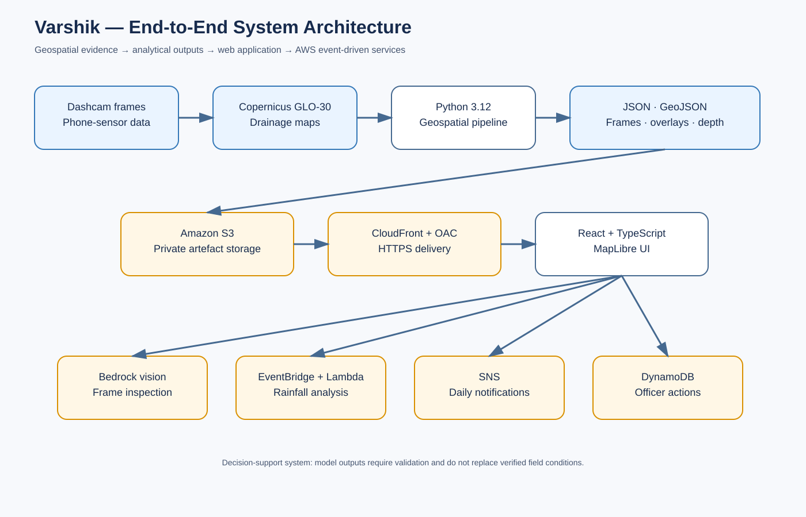
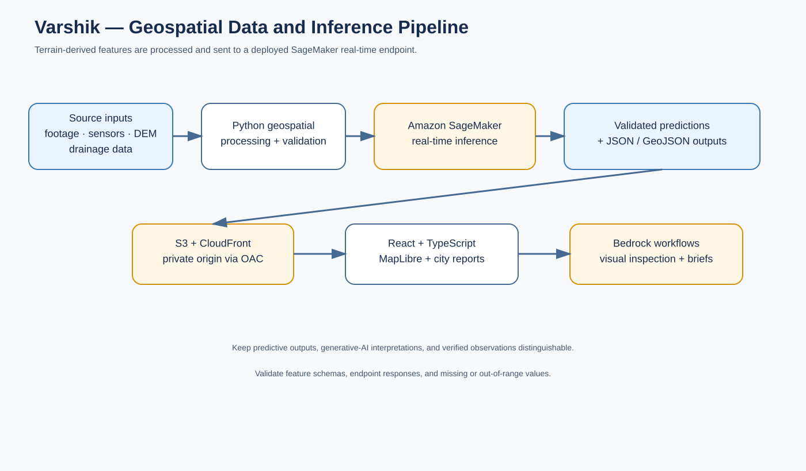
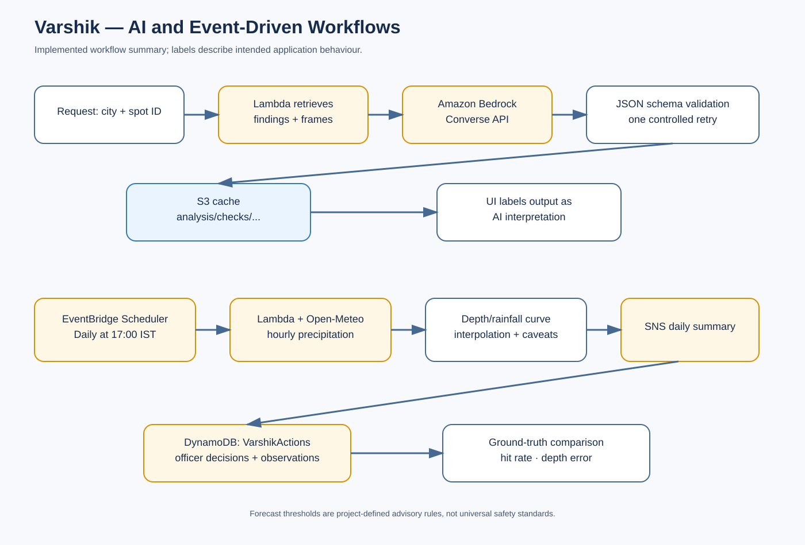

<p align="center"></p>

# Varshik

**Flood-risk analysis that finds the roads likely to hold water before the rain arrives, and shows engineers why.**

[](backend/requirements.txt)
[](ui/package.json)
[](#aws-architecture)
[](infra/)
[](LICENSE)
[](https://github.com/simrithi/floodlens/actions/workflows/ci.yaml)
[](#validation)

**[Live demo](https://d24wvc44c3vaxz.cloudfront.net/)** · **[Demo video](https://youtu.be/nPr0dBLUtUk)** · **[Blog post](https://builder.aws.com/content/3KYn3Kwff6ZOhYY2RbAhKFBszHr/varshik)** · **[Architecture](docs/architecture.md)** · **[What I learned](docs/LEARNINGS.md)** · **[AWS notes](docs/AWS_SUBMISSION.md)**

> **Cost and current state (17 October 2026).** The SageMaker GPU endpoint was first started on 9 October and ran until it was deleted on 16 October 2026 (final deletion at 23:56 IST) to stop idle cost. Hosting it cost about US$17.66 a day: **US$112.89 for SageMaker in October** and **US$117.92 for all services including US$2.73 tax**, before a **US$100 credit**, leaving about **US$17.92** (AWS Cost Explorer on 17 October; the final bill may differ). Everything else costs about US$2.30 so far this month. The analysed surveys, camera frames, AI checks, briefs, alerts and the live site do not use the endpoint, so they work as before. Only processing new footage needs it, and one command recreates it (see [`docs/PROOF.md`](docs/PROOF.md)). `bash infra/verify_aws.sh` reports the stopped endpoint as informational and still passes.

Three deep-learning models (SegFormer-B2, Depth Anything V2, YOLOv8m-seg) run on one Amazon SageMaker GPU endpoint. Their output is fused with smartphone road-height profiles, Copernicus GLO-30 / FABDEM terrain and a water-balance model to estimate standing-water depth under 2-, 5- and 10-year storms, for Delhi and Bengaluru.

Varshik started from a personal place: growing up in Tamil Nadu, the author saw what floods do to families and lost friends to them. The question behind the project is simple: what if we could see which roads will flood *before* it rains?

> **Project status:** Varshik combines a Python-based geospatial analytical pipeline, a React/TypeScript mapping interface, and AWS-backed delivery and event-driven capabilities. The AI-assisted inspection, multilingual briefing, rainfall-analysis, notification, and field-observation workflows described below are implemented. Their outputs remain decision-support signals and must not be treated as authoritative flood warnings or substitutes for verified field conditions.

## Try it in two minutes

No AWS account, no GPU and no `data/` folder needed. This runs the web app on your machine and reads the published results (Delhi, Bengaluru ORR, Bellandur; dashcam frames, overlays, findings) from the live site:

```bash
cd ui
npm install
npm run dev:demo      # open http://localhost:5173
```

The AI frame check, brief and officer log need AWS Function URLs, so they are hidden in this mode. The rest (map, street view, flow lines, rain simulator, reports) works.

Everything else:

```bash
cd backend && python -m pytest tests            # 23 tests, no AWS needed
cd infra && npm install && npm test              # 5 template tests
cd backend && python run_validate.py             # Delhi hotspot validation (needs data/)
cd backend && python run_local.py --rescore      # recompute risk from an analysis.json (needs data/, no GPU)
bash infra/deploy.sh                             # publish the web app (needs your AWS account)
```

`data/` (footage, rasters, outputs, model weights) is git-ignored, so running the full vision pipeline yourself needs your own copy; see [`backend/README.md`](backend/README.md).

## What it does, on one road

1. A phone rides a road and records dashcam frames, GPS and tilt.
2. Each frame goes to the SageMaker endpoint, which returns road regions (SegFormer-B2), relative depth (Depth Anything V2) and potholes (YOLOv8m-seg).
3. Tilt plus distance becomes a **road-height profile** that can reveal underpasses and sags that a 30 m satellite model cannot see.
4. Terrain from the AWS Registry of Open Data (Copernicus GLO-30, FABDEM) and flow routing with pysheds place each segment in its catchment.
5. A water-balance model estimates standing-water depth per ~60 m segment for 2-, 5- and 10-year storms, and the drainage flow that might be needed.
6. The app shows the result as a 3D heatmap with flow lines, and Bedrock (Amazon Nova Lite) writes the plain-language brief an officer can act on.

## Validation

| Evaluation | Result | Reproduce |
|---|---|---|
| Underpass identification, 45 km of Bengaluru ORR | AUC **0.69** with phone road profiles vs **0.47** (chance) for satellite elevation | [`backend/core/roadprofile.py`](backend/core/roadprofile.py), [`reference_bengaluru.geo.json`](backend/validation/reference_bengaluru.geo.json) |
| Kadubeesanahalli underpass | Flagged on both driving directions; reported waterlogged by traffic police, June 2023 | [`ui/src/data/surveys.ts`](ui/src/data/surveys.ts) |
| Synthetic road-dip test | **11 / 11** planted 8 cm dips found; 3 cm dips are not, by design | [`backend/scripts/test_dip_sensitivity.py`](backend/scripts/test_dip_sensitivity.py) |
| Delhi hotspots | AUC **0.66** (95% CI 0.60 to 0.72), 36 reported hotspots vs 400 random main-road points | [`backend/run_validate.py`](backend/run_validate.py), [`reference_hotspots.geo.json`](backend/validation/reference_hotspots.geo.json) |

These results are preliminary. They do not show that Varshik predicts every flood or generalises to every city. See [Limitations](#limitations).

## Repository map

| Path | What is in it |
|---|---|
| [`backend/core/`](backend/core/) | Analysis pipeline: segmentation, depth, detection, geometry, road profile, terrain, hydrology, water depth, scoring |
| [`backend/serve/`](backend/serve/) | SageMaker serving container (`/ping`, `/invocations`) wrapping the three models |
| [`backend/lambdas/`](backend/lambdas/) | Step Functions workers (`invoke-frame`, `assemble-results`, ...), Bedrock functions (`frame-check`, `officer-brief`), `forecast`, `actions` |
| [`backend/scripts/`](backend/scripts/) | Data fetch, hydrology and export scripts, dip-sensitivity test |
| [`backend/validation/`](backend/validation/) | Reference hotspot and underpass data |
| [`infra/`](infra/) | AWS CDK v2 (TypeScript) stack and tests |
| [`ui/`](ui/) | React 19, TypeScript, Vite, MapLibre front end |
| [`docs/`](docs/) | Architecture diagrams, tables, and the project article |

## Contents

- [Try it in two minutes](#try-it-in-two-minutes)
- [What it does, on one road](#what-it-does-on-one-road)
- [Validation](#validation)
- [Repository map](#repository-map)
- [What Varshik does](#what-varshik-does)
- [System overview](#system-overview)
- [Architecture](#architecture)
- [Data and analytical pipeline](#data-and-analytical-pipeline)
- [Frontend](#frontend)
- [AWS architecture](#aws-architecture)
- [Amazon SageMaker inference](#amazon-sagemaker-inference)
- [AI and event-driven capabilities](#ai-and-event-driven-capabilities)
- [Data contracts and output layout](#data-contracts-and-output-layout)
- [Local development](#local-development)
- [Configuration](#configuration)
- [Security and operational controls](#security-and-operational-controls)
- [Data provenance and licensing](#data-provenance-and-licensing)
- [AI used](#ai-used)
- [What I learned](#what-i-learned)
- [Tests and verification](#tests-and-verification)
- [Proof that the AWS services are live](#proof-that-the-aws-services-are-live)
- [What the results do and do not show](#what-the-results-do-and-do-not-show)
- [Limitations](#limitations)
- [Roadmap](#roadmap)
- [Contributing](#contributing)

## What Varshik does

Varshik combines several sources of evidence to help surface locations that may warrant closer investigation.

- **Road-level visual evidence:** dashcam frames provide context about road geometry, underpasses, kerbs, visible drainage inlets, standing water, and other visible conditions.
- **Sensor observations:** phone-sensor data contributes route-specific context, subject to the sensors available and their measurement quality.
- **Terrain elevation:** a bare-earth elevation model helps identify broad depressions and terrain patterns that may influence surface-water movement.
- **Drainage infrastructure:** official drainage maps provide spatial context for mapped drainage networks and nearby infrastructure.
- **Analytical outputs:** the pipeline produces findings, depth-related artefacts, flow features, kerb geometries, and other outputs that can be inspected in the application.

The application focuses on **Delhi and Bengaluru**. It presents analysis through city reports and an interactive map so that a user can examine a location in its geographic context rather than relying on an isolated score or number.

### What Varshik is not

Varshik should not be treated as a real-time flood-warning authority or a replacement for hydraulic modelling, field inspections, or official emergency procedures. A mapped hotspot is not proof that flooding is occurring. A model-derived depth is an estimate, not a direct measurement, unless independently verified.

## System overview



*Figure 1. End-to-end architecture connecting geospatial inputs, analysis outputs, the web application, and AWS services.*

More diagrams (one survey through the pipeline, failure handling, the AI guardrails, publishing) are in [`docs/architecture.md`](docs/architecture.md).

The pipeline and frontend have separate responsibilities:

1. The **Python pipeline** processes survey and geospatial inputs and writes analysis artefacts.
2. The **output layer** exposes structured JSON, GeoJSON, images, and depth-related files.
3. The **frontend** requests the required artefacts over HTTP and renders them as maps, reports, and visual evidence.
4. The **cloud delivery layer**, serves the built frontend and approved analysis artefacts through Amazon S3 and Amazon CloudFront.
5. The serverless capabilities operate alongside the analytical pipeline while preserving the boundary between model estimates and verified observations. Amazon SageMaker provides a real-time GPU endpoint that serves the three computer-vision models (SegFormer-B2, Depth Anything V2, YOLOv8m-seg) used in the per-frame analysis.

## Architecture

### 1. Analytical backend

The backend uses **Python 3.12** and a project-local environment managed with `uv`. It processes the project's survey data and produces sequence-level and city-level outputs.

Processing artefacts are kept separate from the frontend. This lets the UI request the results needed for a given view without rerunning the entire analytical workflow whenever a user opens a map or changes a report.

### 2. Data interface

The frontend reads pipeline outputs through an HTTP base path controlled by `VITE_ANALYSIS_BASE`. The documented default is `/analysis`.

This abstraction separates the logical path used by the frontend from the physical location of the files. In development, a local Vite setup can expose the outputs; in a production deployment, the same paths can be served from object storage through a CDN.

### 3. Frontend application

The web application uses:

- **React 19** for component-based UI.
- **TypeScript** for static type checking and explicit data contracts.
- **Vite 8** for development and build tooling.
- **MapLibre** for map rendering and geospatial interaction.

The principal route patterns are:

- `/` — application entry point.
- `/map` — interactive map.
- `/report/<city>` — city-specific report.

TypeScript can catch many implementation errors during development, but it does not validate arbitrary JSON received at runtime. External analysis files should still be checked for missing or malformed fields where appropriate.

## Data and analytical pipeline

### Geospatial inputs

Varshik combines inputs that describe different aspects of the environment. They should not be treated as interchangeable:

| Input | What it contributes | Important limitation |
|---|---|---|
| Dashcam frames | Visual context for road-level conditions | Visibility depends on camera angle, lighting, occlusion, and survey timing |
| Phone-sensor observations | Context associated with a surveyed route | Reliability depends on sensor availability, calibration, and recording quality |
| Bare-earth elevation | Broad terrain gradients and potential low points | Coarse resolution cannot represent every kerb, road crown, or narrow channel |
| Official drainage maps | Mapped drainage infrastructure | May omit undocumented, modified, blocked, or outdated infrastructure |
| Pipeline outputs | Derived findings and depth/flow-related artefacts | Accuracy depends on input quality and the assumptions of the underlying analysis |

### Elevation data and AWS Registry of Open Data

The project uses the **AWS Registry of Open Data** as a source for the **Copernicus GLO-30 Digital Elevation Model** relevant to terrain analysis. The dataset has approximately 30-metre spatial resolution and can help identify broad topographic patterns.

The Registry of Open Data is a data-access resource; it does not itself perform Varshik's terrain analysis. The elevation model is an input to the project's workflow, not a complete flood simulation.

At this resolution, terrain data may not capture street-scale features that govern urban drainage. Results should therefore be interpreted alongside road geometry, drainage information, visual evidence, and the assumptions of the analytical model. Where precise street-level hydraulic behaviour is required, higher-resolution survey data may be necessary.

### Why JSON and GeoJSON

Varshik produces structured artefacts rather than requiring the browser to understand the internals of the Python pipeline.

- **JSON** represents hierarchical findings, metadata, and numerical outputs.
- **GeoJSON** represents spatial features such as points and lines with associated properties.
- **Image artefacts** provide frames, overlays, and depth visualisations for inspection.

This creates a boundary between analysis and presentation. It also means output schemas need to remain consistent, and clients should handle missing data and unsupported geometries safely.



*Figure 2. Source data is processed into structured outputs, which are delivered to the React and MapLibre application.*

## Frontend

The interface uses MapLibre to place findings and spatial features in geographic context. This matters because a location's relationship to nearby roads, drainage features, and terrain can be more informative than a standalone numerical value.

The data base path is configured with:

```text
VITE_ANALYSIS_BASE=/analysis
```

If this variable is not supplied, the application uses `/analysis` as its default.

The frontend build and analysis artefacts are deployed with an explicit path convention. Validate the application through its delivery URL as well as checking the underlying storage objects.

## AWS architecture

Everything below is deployed in `us-east-1` and in use.

| Service | What it does here |
|---|---|
| AWS Registry of Open Data | Source of the Copernicus GLO-30 elevation model |
| Amazon SageMaker | One real-time GPU endpoint (`ml.g4dn.xlarge`) serving SegFormer-B2, Depth Anything V2 and YOLOv8m-seg |
| AWS Step Functions | `floodlens-pipeline`: a serial Map over a survey's frames (the endpoint is a single worker), then an assemble step; a failure ends in a Fail state |
| Amazon EventBridge | A rule starts the pipeline when a survey's `frames.json` lands in the raw bucket; Scheduler runs the daily forecast at 17:00 IST |
| AWS Lambda | Nine functions: start-run, get-upload-url, get-run-status, invoke-frame, assemble-results, frame-check, officer-brief, forecast, actions |
| Lambda Function URLs | Three used by the app: frame check, brief, officer log. The upload and run-status URLs exist but return 403 and are not used |
| Amazon Bedrock | Amazon Nova Lite (frame check, English brief) and Amazon Nova Pro (Hindi brief) |
| Amazon S3 | Raw footage, analysis outputs, and the site bucket behind CloudFront |
| Amazon CloudFront | HTTPS delivery of the app and its analysis files |
| AWS CDK v2 (TypeScript) | The web stack only: site bucket and CloudFront (see below) |
| Amazon SNS | The daily alert email |
| Amazon DynamoDB | `floodlens-runs` (pipeline runs) and `FloodLensActions` (officer approvals and ground reports) |
| AWS Systems Manager Parameter Store | The officer passcode, as a SecureString |
| Amazon ECR | Container images for the SageMaker server and the assemble Lambda |
| Amazon CloudWatch | Lambda logs (14-day retention), error alarms, a Bedrock throttling alarm |
| AWS Budgets | A US$25 monthly budget with alerts at 50%, 80% and 100% |
| AWS IAM | One role each for SageMaker, Step Functions and the scheduler; one shared role for the nine Lambdas |

### Amazon S3 and Amazon CloudFront

Three buckets: `floodlens-raw-...` (uploaded footage), `floodlens-outputs-...` (pipeline outputs, frame records, cached AI results) and the site bucket. The site bucket holds the built app at its root and the analysis files under `analysis/`. It is private, with all public access blocked and server-side encryption, and CloudFront reaches it through Origin Access Control. The distribution uses HTTPS only, HTTP/2 and 3, and compression.

Client-side routes such as `/map` and `/report/bengaluru` are rewritten to `/index.html` by a CloudFront Function on the viewer-request event. There are deliberately no 403 or 404 error-page rewrites, so a missing analysis file stays a visible error instead of turning into the app shell.

| Content | Cache |
|---|---|
| `index.html` | No cache |
| Hashed assets | One year, immutable |
| JSON and GeoJSON analysis | Five minutes |
| Analysis images | One day |

Raw footage and rasters are never uploaded to the site bucket. A finished survey is published with [`backend/scripts/publish_site.sh`](backend/scripts/publish_site.sh).

### AWS CDK

CDK defines one stack, `FloodLensWeb`: the site bucket, the CloudFront distribution, the routing function, the cache policies and a `Project=FloodLens` tag, with five tests in [`infra/test/`](infra/test/). Everything else (SageMaker, Step Functions, the Lambdas, DynamoDB, SNS, EventBridge, ECR, IAM) was created with the AWS CLI and the JSON files in [`backend/lambdas/`](backend/lambdas/), and those resources are not tagged. Moving them into CDK is open work.

## Amazon SageMaker inference

> *Note (16 October 2026): the SageMaker endpoint was deleted after submission to avoid idle cost (about US$0.74 an hour). The model, the endpoint configuration and the container image are kept, and one command recreates it in about 10 minutes. The checks recorded here were made on 12 October while it was running.*

Varshik runs its computer-vision analysis on **Amazon SageMaker** through a single **real-time endpoint** (`floodlens-analyze`, one production variant on `ml.g4dn.xlarge`, one instance). The serving container ([backend/serve/](backend/serve/)) loads three deep-learning models and runs them on each dashcam frame:

| Model | Task | Role |
|---|---|---|
| SegFormer-B2 (Cityscapes fine-tuned) | Semantic segmentation | Road, footpath, kerb and vehicle regions |
| Depth Anything V2 (Small) | Monocular depth estimation | Relative surface geometry; not calibrated elevation |
| YOLOv8m-seg | Instance segmentation | Potholes and surface defects |

### Inference flow

1. **Orchestrate:** a Step Functions Map state iterates over the frames of a survey and calls the `invoke-frame` Lambda once per frame.
2. **Invoke the endpoint:** the Lambda sends a JSON request (`image_s3_uri`, frame metadata, pothole confidence, output location) to `floodlens-analyze` using `sagemaker-runtime`.
3. **Analyse the frame:** the container downloads the image from S3, runs segmentation, depth estimation and pothole detection, and applies the geometry and DEM lookup.
4. **Write outputs:** overlay and depth images go to the outputs bucket, the full record is saved to `frame-records/`, and the Lambda returns a small pointer. Step Functions limits a state to 256 KB, which a Map over a few hundred frames would exceed.
5. **Assemble:** the `assemble-results` Lambda reads the records back and combines them with the road profile, terrain, drains and the water model into `analysis.json`.

The endpoint implements the standard SageMaker custom-container contract (`GET /ping`, `POST /invocations`). Relative depth is never treated as a survey, and no model output is a verified field measurement.

## AI and event-driven capabilities



*Figure 3. Event-driven workflows for visual inspection, rainfall analysis, notifications, and field observations.*

### 1. Frame check (Amazon Bedrock, Nova Lite)

The `frame-check` Lambda takes a city and spot id, reads the spot's best dashcam frame and up to three more from its stretches, and asks Nova Lite through the Converse API for a fixed JSON answer: whether it is an underpass, whether a drain inlet is visible, its condition, any blockage (garbage, silt, vegetation, parked vehicle), standing water or staining, and visible kerb openings. The prompt tells the model to answer `unclear` instead of guessing. The reply is validated against the schema with one retry; if it still fails, an error is returned, not malformed data.

The result is evidence for an engineer to verify. It is never an input to the water model or any score, and the app labels it that way. It is cached at `analysis/checks/<city>/<spotId>.json` with the model id and time, and also copied to the site bucket. At most 30 fresh checks run per hour overall, counted in a small S3 object; cached results do not count.

### 2. Officer brief (Bedrock, Nova Lite and Nova Pro)

The `officer-brief` Lambda writes a one-page brief in English (Nova Lite) or Hindi (Nova Pro) from the findings. The model sees only the spots and headline facts, refers to each spot only by its id, and never writes a place name; code adds a legend with the exact names. The output is rejected unless every number appears in the findings (Latin and Devanagari digits both count) and every spot id is present, with up to three attempts. Briefs are cached by city and language with the model id and a hash of the findings, so they regenerate only when the findings change. At most 20 fresh briefs run per hour overall.

The check proves numbers and ids, not fluency or that a number sits next to the right place. The Hindi brief is machine-written and has not been reviewed by a fluent reader. Kannada was offered earlier and removed until it can be reviewed (see Future scope).

### 3. Daily forecast (EventBridge Scheduler and Lambda)

At 17:00 IST the `forecast` Lambda reads each city's findings, fetches the next day's hourly rain at each spot from Open-Meteo, and interpolates the spot's own depth-versus-rain curve from `analysis.json`. Values beyond the curve are clamped to its end, not extrapolated.

The curves are built from 15-minute design storms and Open-Meteo gives hourly totals. There is no sourced conversion, so the hourly value is used as it is, and every alert says: "hourly rain used as-is; 15-minute burst not modelled".

Advisories are project-defined, not safety standards:

| Expected depth at a flagged spot | Action in the alert |
|---|---|
| 15 cm or more | Consider closing |
| 5 cm to below 15 cm | Clear inlets, watch |
| Below 5 cm | Not included |

### 4. Alert email (Amazon SNS)

When any spot reaches 5 cm, one message per city per day is published to the `floodlens-alerts` topic: spot ids, forecast rain, expected depth and action, with a link to the map. The alert file `analysis/alerts/<city>-<date>.json` is written first and a re-run finds it and does nothing, so a retry cannot send a second email. Email recipients must confirm their subscription.

### 5. Officer log (DynamoDB)

The `actions` Lambda stores two kinds of record in `FloodLensActions` (partition key `city#spotId`, sort key `timestamp#kind`): an officer's approval or decline of a suggested action, and a ground report of whether a spot flooded, with an optional depth. Writes need a shared officer passcode kept in Systems Manager Parameter Store as a SecureString at `/floodlens/officer-passcode`; writes are refused until it is set, and the passcode is never logged. Reading the log needs no passcode.

The shared passcode is a prototype control. It gives no individual identity or per-user audit trail. [`backend/scripts/compare_observations.py`](backend/scripts/compare_observations.py) compares the ground reports with the 2-year-storm prediction, which is only meaningful on a day of heavy rain.

## Data contracts and output layout

The output structure includes sequence-level folders and city-level files. Names and availability depend on the pipeline run and the data being analysed.

```text
data/
└── outputs/
    ├── <sequence>-<size>/
    │   ├── analysis.json
    │   ├── frames/
    │   ├── overlays/
    │   ├── depth/
    │   ├── flow.geojson
    │   └── kerb_lines.geojson
    ├── findings-<city>.json
    ├── drains*.geojson
    ├── hollows*.png
    ├── hollows*.json
    ├── reported-bengaluru.json
    ├── validation.json
    └── route_profile.json
```

### Important output artefacts

| Artefact | Purpose |
|---|---|
| `analysis.json` | Sequence-level analysis results |
| `frames/` | Survey images used by the application |
| `overlays/` | Visual artefacts generated by the analytical workflow |
| `depth/` | Depth-related outputs |
| `flow.geojson` | Spatial flow features |
| `kerb_lines.geojson` | Kerb-related geometries |
| `findings-<city>.json` | City-level findings |
| `drains*.geojson` | Drainage-related spatial data |
| `hollows*.png` / `hollows*.json` | Hollow/depression-related artefacts |
| `reported-bengaluru.json` | Reported Bengaluru data |
| `validation.json` | Validation output |
| `route_profile.json` | Route profile data |

Consumers should treat these files as external data: validate expected fields, handle missing objects, and avoid assuming that every sequence has every optional artefact.

## Local development

Prerequisites: Python 3.12, `uv`, Node.js 22, and the project's `data/` folder (footage, rasters, outputs), which is git-ignored.

```bash
# backend
uv venv backend/.venv && uv pip install -r backend/requirements.txt pytest
cd backend && python -m pytest tests          # Lambda logic and scripts; no AWS or GPU needed

# web app (set VITE_ANALYSIS_BASE if the analysis files are served from elsewhere)
cd ui && npm install && npm run dev

# infrastructure
cd infra && npm install && npm test
```

More commands (running the pipeline, validation, map layers, publishing a survey) are in [`backend/README.md`](backend/README.md).

To check a deployment, open `/`, `/map`, `/report/delhi` and `/report/bengaluru`, switch between the three surveys, and open street view on a spot. A missing optional layer file hides that layer; a missing `analysis.json` shows "No pipeline output yet".

## Configuration

| Setting | Purpose |
|---|---|
| `VITE_ANALYSIS_BASE` | Where the analysis files are served from (default `/analysis`) |
| `VITE_API_FRAME_CHECK`, `VITE_API_BRIEF`, `VITE_API_ACTIONS` | The Function URLs for the frame check, officer brief and officer log. Each feature is hidden when its URL is not set |
| `/floodlens/officer-passcode` | SSM SecureString holding the officer passcode |
| Region | `us-east-1` |

Never put credentials or the officer passcode in frontend variables. Everything bundled into the app can be read by its users.

## Security and operational controls

- **Storage and delivery.** The site bucket is private, with public access blocked and encryption on; CloudFront reaches it through Origin Access Control. Raw footage and rasters are not published.
- **Public endpoints.** The three Function URLs for the frame check, brief and officer log are public because the browser calls them. CORS limits browsers to the app's origin and is not authentication. The real limits are server-side: 30 fresh frame checks and 20 fresh briefs per hour overall, cached results served free, and the passcode for officer-log writes. Request bodies, ids and allowed values are validated.
- **IAM.** SageMaker, Step Functions and the scheduler each have their own role. The nine Lambdas share one role, scoped by resource ARN, with Bedrock invocation limited to Nova Lite and Nova Pro. A role per function is open work.
- **Monitoring.** Lambda and endpoint logs keep 14 days. An error alarm covers each of the nine Lambdas, and a separate alarm watches Bedrock throttling.
- **Cost.** A US$25 monthly budget alerts at 50%, 80% and 100%. Budget alerts do not stop usage. The SageMaker endpoint is the dominant cost (about US$0.74 an hour on-demand; check current pricing), so delete it when it is not needed; teardown steps are in [`docs/AWS_SUBMISSION.md`](docs/AWS_SUBMISSION.md).
- **Reporting a problem.** See [`SECURITY.md`](SECURITY.md).

## Data provenance and licensing

Varshik combines source footage, elevation data, drainage geometries, analytical outputs, and generated visualisations. Each category has its own provenance and limitations.

The KartaView frames used by the project are licensed under **CC BY-SA 4.0**, and required attribution must remain visible in the application. Raw footage under `data/kartaview/` and raster inputs under `data/geo/` are excluded from public deployment unless redistribution rights and an explicit data-handling review permit otherwise.

A deployment should include only the assets required by the application and should preserve applicable licence and attribution requirements. The existence of a file in a development repository does not automatically grant permission to redistribute it.

## AI used

Five models, nothing else. Three run on SageMaker and read pictures; two run on Bedrock and write short text. The water model, drainage sizing and forecast interpolation are plain physics and arithmetic, not AI.

| Model | Where it runs | What it does | Never does |
|---|---|---|---|
| SegFormer-B2 (Cityscapes fine-tuned) | SageMaker endpoint | Labels each pixel: road, footpath, kerb, vehicle | Measure anything on its own |
| Depth Anything V2 (Small) | SageMaker endpoint | Relative depth from one image | Give calibrated elevation |
| YOLOv8m-seg (pothole weights) | SageMaker endpoint | Finds and outlines potholes | Decide that a road floods |
| Amazon Nova Lite (`us.amazon.nova-lite-v1:0`) | Bedrock | Reads a spot's dashcam frames for a visible drain inlet and blockage (frame check); writes the English officer brief | Change a number or a place name |
| Amazon Nova Pro (`us.amazon.nova-pro-v1:0`) | Bedrock | Writes the Hindi officer brief | Change a number or a place name |

Amazon Nova 2 Lite was compared while choosing a brief model and is not used; Nova Premier is no longer available.

Guardrails on the two Bedrock models: the frame check is evidence for a person to verify and never feeds a score; a brief is rejected unless every number appears in the findings and every spot id is present; place names are added by code, not written by the model; fresh generations are rate-limited (30 and 20 per hour). Details are in "AI and event-driven capabilities".

## Tests and verification

### Automated (also run by CI on every push)

| Suite | Count | What it covers |
|---|---|---|
| Backend (`backend/tests`, pytest) | 23 | Brief number check across Latin and Devanagari digits, unverified numbers detected, brief input trimmed of internal text, Kannada not offered, brief and frame-check rate limits, frame lookup on the real data layout, a missing cache key is not an error, the S3 pointer returned by `invoke-frame`, forecast interpolation and clamping, rejection of bad or path-like city, spot and language values, and `compare_observations.py` |
| Infrastructure (`infra/test`, Jest) | 5 | Private encrypted bucket, Origin Access Control with HTTPS only, SPA routing by function with no error-page rewrites, cache lifetimes, `Project` tag |
| Web app | build | `tsc -b` type-check and production build |
| Dependencies | audit | `npm audit --omit=dev`: 0 vulnerabilities in `ui` and `infra` |
| Secrets | scan | No AWS keys, passcodes or private keys in tracked files or git history; `.env.production` is git-ignored |

### Live checks on the deployed account (12 October 2026)

| Area | Check | Result |
|---|---|---|
| Web app | `/`, `/map`, `/report/delhi`, `/report/bengaluru` | All 200 |
| Analysis data | 35 files across Delhi (1280p and 4K), Bengaluru ORR and Bellandur: analysis, flow lines, frames, overlays, depth, findings, layers, cached briefs and checks | All 200 |
| SageMaker | Endpoint status; a real inference through `invoke-frame` | InService; returned a full frame record (ground, kerbs, depth, overlays) (checked 12 October; stopped on 16 October, see the note below) |
| Pipeline | ORR (422 frames), Bellandur (133), Delhi 4K (207) through Step Functions and assemble | All produced `analysis.json` |
| Failure handling | A run forced to fail | Step Functions shows `FAILED` (`PipelineFailed`) and the run record says `failed` |
| Frame check | Fresh call on all 6 current spots (Delhi 2, Bengaluru 4) | 6 of 6 valid answers from Nova Lite; two frames checked by eye and the answers were reasonable |
| Officer brief | Fresh English and Hindi for both cities | 4 of 4 passed verification (Nova Lite, Nova Pro) |
| Forecast | Forced 100 mm/hr run | Delhi S1 14.0 cm, matching the depth curve; the test alert was removed. Schedule `cron(0 17 * * ? *)` Asia/Kolkata is enabled |
| Public endpoints | Bad JSON, path-like city and spot, unknown spot, unsupported language, missing fields, missing city | All refused with 400 or 404 and no data read |
| CORS | A request from another origin | Not allowed |
| Officer log | Write with a wrong or placeholder passcode; read | 401; read returns 200 |
| Storage | Public access on all three buckets | Blocked on all three |
| IAM | The shared Lambda role | Scoped by resource ARN; no wildcard actions |
| Data stores and messaging | DynamoDB tables, SNS subscription, EventBridge rule | Tables active; subscription confirmed; rule enabled |
| Compute | All nine Lambdas, ECR images, CloudFront | Active, last update successful; images present; distribution deployed |
| Monitoring | Log groups, alarms | 10 log groups at 14-day retention; 10 alarms (an error alarm per Lambda and one for Bedrock throttling) |

### Not verified, and known gaps

- **No automated browser test.** The dashboard, street view, walkthrough and the printable report were exercised by hand and through their data files, not by a test, and there are no front-end unit tests.
- **No load test.** The rate limits are unit-tested but were not tried under concurrent load.
- **Daily flood-alert email.** SNS delivery is proven by the alarm email in the proof section, but the forecast Lambda's own flood-alert email has not been observed yet.
- **Security headers.** CloudFront does not add HSTS, `X-Content-Type-Options` or a content security policy. Adding a response-headers policy to the CDK stack is open work.
- **Brief language quality.** The Hindi brief checks numbers and ids, not fluency, and has not been reviewed by a fluent reader. Kannada was tried and removed.
- **The scientific results are preliminary.** See "What the results do and do not show".
- **The upload and run-status Function URLs return 403 and are not used by the app.** `get-upload-url` hands out presigned upload links, so it is left closed until it has authentication.

## What I learned

The short version; the full list, each tied to the event it came from, is in [`docs/LEARNINGS.md`](docs/LEARNINGS.md).

- **A green run proves nothing.** A 422-frame run showed SUCCEEDED and produced no output. The result file is the success signal.
- **Learn the service limits before the long job.** Step Functions' 256 KB state limit, a 60-second Lambda timeout, a Function URL that needs two permissions, S3 returning AccessDenied for a missing key, and BuildKit manifests Lambda rejects each cost hours.
- **Test against what the system really produces.** Two Lambdas looked for a field that real data does not have and skipped every spot without an error.
- **Make the model unable to change facts.** A Kannada brief turned Connaught Place into Kanyakumari Place. Names are now added by code, and anything a model writes is checked before it is shown.
- **Do not ship what I cannot read.** Kannada was removed until a fluent reviewer can check it.
- **Say the weak numbers.** Terrain alone scored AUC 0.57, and the stretch-level test 0.45, next to 0.66 and 0.69.
- **Cost shapes the design.** One idle GPU endpoint is about US$0.74 an hour, which is why frames run one at a time.

## Proof that the AWS services are live

Run `bash infra/verify_aws.sh` with access to the account. It is read-only and checks every service below; on 12 October 2026 it passed **40 of 40** (the full output is in [`docs/PROOF.md`](docs/PROOF.md)).

| Service | Live evidence |
|---|---|
| SageMaker | `floodlens-analyze` InService (`ml.g4dn.xlarge`); a real inference returned a full frame record |
| Step Functions | `floodlens-pipeline` active; processed 422 + 133 + 207 frames; a forced failure ends FAILED |
| Lambda | 9 of 9 functions Active; 3 public Function URLs |
| Bedrock | Fresh frame checks on 6 of 6 spots and 4 of 4 briefs passed (Nova Lite, Nova Pro) |
| EventBridge | Frames-uploaded rule enabled; Scheduler `cron(0 17 * * ? *)` Asia/Kolkata |
| SNS | Email subscription confirmed; an alarm email was delivered (below) |
| DynamoDB | `floodlens-runs` and `FloodLensActions` ACTIVE |
| Systems Manager | Officer passcode stored as a SecureString; wrong passcodes refused (401) |
| S3 and CloudFront | 3 private buckets; distribution deployed; app routes and 42 analysis files return 200 |
| ECR, CloudWatch, Budgets | Images present; 10 alarms (none firing), 14-day logs; US$25 budget |

> *Note (16 October 2026): the SageMaker endpoint was deleted after submission to avoid idle cost (about US$0.74 an hour). The model, the endpoint configuration and the container image are kept, and one command recreates it in about 10 minutes. The checks recorded here were made on 12 October while it was running. To recreate it: `aws sagemaker create-endpoint --endpoint-name floodlens-analyze --endpoint-config-name floodlens-analyze-config --region us-east-1`*

### The SNS email, as received

The SNS topic `floodlens-alerts` has a confirmed email subscription. To prove the path from AWS to an inbox, I ran a pipeline execution that was made to fail on purpose; the alarm fired and AWS sent this email:

> **ALARM: "floodlens-invoke-frame-errors" in US East (N. Virginia)**
> From: AWS Notifications `<no-reply@sns.amazonaws.com>`, received 5:24 AM IST (23:54:53 UTC, 11 October 2026)
> *You are receiving this email because your Amazon CloudWatch Alarm "floodlens-invoke-frame-errors" in the US East (N. Virginia) region has entered the ALARM state, because "Threshold Crossed: 1 datapoint [1.0 (11/10/26 23:49:00)] was greater than or equal to the threshold (1.0)."*
> State change: OK -> ALARM. Metric: `AWS/Lambda` `Errors`, `FunctionName = floodlens-invoke-frame`, Sum over 300 seconds, missing data not breaching. Alarm action: `arn:aws:sns:us-east-1:<account>:floodlens-alerts`.

The daily flood-alert email (the forecast Lambda's own message) has not yet been observed: it runs at 17:00 IST and only sends when tomorrow's forecast reaches 5 cm at a spot.

## What the results do and do not show

Measured by the scripts in this repository, on Delhi's 36 publicly reported waterlogging hotspots against 400 random main-road points (`backend/run_validate.py`). The numbers are weaker than a headline AUC suggests, and the weak ones are listed first.

| Check | Result | What it means |
|---|---|---|
| Terrain alone (bare-earth height against surroundings) | AUC **0.57**, 95% CI 0.46 to 0.68 | The interval includes chance. Terrain by itself does not separate hotspots from ordinary roads here. |
| Predicted 2-year-storm water depth, terrain and drains only, within 60 m | AUC **0.66**, 95% CI 0.60 to 0.72 | Modest but real. This is the figure used in the article. It uses the water model, not terrain alone. |
| Stretch-level risk from the dashcam survey against the same hotspots | AUC **0.45**; 10 of 42 stretches within 300 m of a hotspot; top-5 precision 0.0 | The survey covers one 7.6 km route with only one reported hotspot nearby, so this test cannot confirm or refute the model. It did not support it. |
| Bengaluru underpasses along 45 km, phone road profile against satellite elevation | AUC **0.69** against **0.47** | The one result where the phone sensor clearly adds signal. |

Practical implications of how the system is built and run:

- **Coverage is three surveys.** Delhi (ITO to Connaught Place), the Bengaluru ORR and Bellandur. Nothing here shows it generalises to another city or rainfall regime.
- **Spot ids are not stable.** Spots are numbered by priority each time findings are rebuilt, so S1 can become a different place. Cached frame checks are keyed by city and spot id and go stale after a rebuild; regenerate them.
- **The AI never feeds the numbers.** Bedrock output (frame checks, briefs) is shown as evidence for a person to verify. It does not change a depth, a score or a drainage figure. A brief is rejected unless every number in it appears in the findings and every spot id is present; place names are added by code.
- **Hourly forecast, burst curves.** The daily alert applies Open-Meteo's hourly rain to depth curves built from 15-minute design storms, because no sourced conversion exists. Every alert says so. Treat it as a prompt to look, not a prediction.
- **One GPU worker.** The endpoint is a single `ml.g4dn.xlarge`, so frames are analysed one at a time: roughly 6 to 10 seconds each, about 45 minutes for the 422-frame ORR survey. At about US$0.74 per hour on-demand (check current pricing) it costs around US$530 a month if left running; delete it when not in use.
- **Check for the output, not just the status.** A failed pipeline run now ends in a Fail state, so Step Functions shows FAILED and the run record in `floodlens-runs` says `failed` (earlier runs ended cleanly and showed SUCCEEDED when they had failed). The result of a good run is `<sequence>-<size>/analysis.json`. Per-frame results are written to S3 (`frame-records/`) because a Map over a few hundred frames exceeds Step Functions' 256 KB state limit.
- **Three public Function URLs.** Frame check, brief and officer log are open to the internet. CORS limits browsers, not other callers. The real limits are server-side: 30 fresh frame checks and 20 fresh briefs per hour overall, cached results served free, and writes to the officer log need a passcode. Anyone can use up the hourly quota; the effect is that new generations pause, not that cost runs away. Reading the officer log needs no passcode.
- **Machine-written Hindi.** The briefs use Amazon Nova Pro and are checked for numbers and spot ids, not for fluency. Have a fluent reader review them before use.
- **Officer reports are not measurements.** The log stores what an officer says happened. `backend/scripts/compare_observations.py` compares those reports with the 2-year-storm prediction, which is only meaningful on a day of heavy rain.
- **Licences.** KartaView frames are CC BY-SA 4.0 and must stay attributed in the app. KSRSAC's Bengaluru drain map is public domain via OpenCity. FABDEM is distributed under non-commercial terms; confirm them before any commercial use.

## Limitations

### Terrain resolution

A roughly 30-metre elevation model supports broad terrain analysis but may not represent street-scale drainage features. More detailed elevation data may be required for precise hydraulic modelling.

### Incomplete infrastructure records

Drainage maps can be outdated or incomplete. A mapped drain does not establish that it exists in the field, is unobstructed, or has sufficient capacity.

### Visual ambiguity

Dashcam images can be affected by occlusion, lighting, motion blur, camera position, and survey timing. A visible inlet does not prove hydraulic functionality; an image without standing water does not prove a road is flood-safe.

### Model and forecast uncertainty

Depth estimates depend on the analytical model and its assumptions. Hourly rainfall forecasts cannot automatically be treated as short-duration design storms. Interpolation outside the supported range can be misleading.

### AI reliability

Vision and language models can produce incorrect interpretations. Schema checks, constrained prompts, numerical validation, and caching reduce certain failure modes but do not guarantee factual correctness. AI-generated outputs require appropriate human review.

### Ground truth

Reliable evaluation requires verified field observations across representative locations and rainfall events. Missing reports must not be treated as proof that flooding did not occur.

## Roadmap

Open work, in the order it matters:

1. **More validation.** Compare predicted depth and hotspot rankings with verified field observations across more locations and rain events. Today's evidence is three surveys and one set of reported Delhi hotspots.
2. **Infrastructure as code for the rest.** Move SageMaker, Step Functions, the Lambdas, DynamoDB, SNS, EventBridge and IAM into CDK, and give each Lambda its own role.
3. **Forecast calibration.** Replace the hourly-as-burst assumption with a sourced conversion for each city.
4. **Review of the machine-written briefs.** Have a fluent reader check the Hindi before Kannada and other local languages are added.
5. **Identity.** Replace the shared officer passcode with individual identities for any operational use.
6. **Security headers.** Add a response-headers policy (HSTS, content-type options, a content security policy) to the CloudFront stack.
7. **Cheaper inference.** The real-time endpoint cannot scale to zero; asynchronous inference or a run-on-demand endpoint would cut idle cost.
8. **Kerb lines for the Bengaluru ORR.** The continuity script is currently written for the Delhi survey.

### Future scope

- **Reports in Kannada and other local languages.** Today the officer brief can be shown in English and Hindi, but the printable report itself is in English. Kannada was tried and removed because the machine translation was not good enough. Next is printing the whole report (findings, causes, fixes, the brief) in Kannada and other local languages, so a ward engineer can hand it to a team in the language they work in. The machine-written text must be reviewed by fluent readers first, and place names stay in English letters beside the local script so they can be cross-checked.
- **Mapping every road with police vehicles.** The surveys so far are three routes. Police patrol vehicles already drive a city's roads every day, so a phone or dashcam on each one could supply the footage and sensor data the pipeline needs, and each stretch could be covered and refreshed within about a year. This is a plan, not something tested here. The measured rate is about 6.8 km of footage processed in 46 minutes on one GPU worker, so compute is not the limit; collecting footage is. It would also need agreements with the police and city, blurring of faces and number plates before footage is stored, and checks that phone-sensor road profiles hold up across devices and vehicles.

## Contributing

See [`CONTRIBUTING.md`](CONTRIBUTING.md). In short: no invented numbers, AI output stays evidence and never feeds a number, and check for the output file, not just a green run.

## Releases and licence

The code is licensed under [Apache-2.0](LICENSE). The data it uses keeps its own licences; see [`NOTICE`](NOTICE) (note that FABDEM is non-commercial). The version submitted to the AWS hackathon is frozen as the tag `aws-hackathon-submission`, and releases are listed under [Releases](https://github.com/simrithi/floodlens/releases).

## Acknowledgements

Footage: KartaView contributors (CC BY-SA 4.0). Elevation: Copernicus GLO-30 through the AWS Registry of Open Data, and FABDEM. Bengaluru drains: KSRSAC 2022 via OpenCity (public domain). Rainfall forecasts: Open-Meteo. Models: SegFormer, Depth Anything V2, YOLOv8 and the Amazon Nova models.
