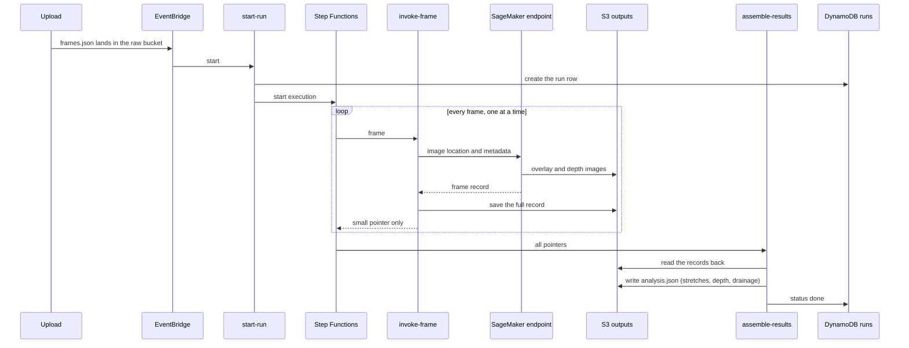
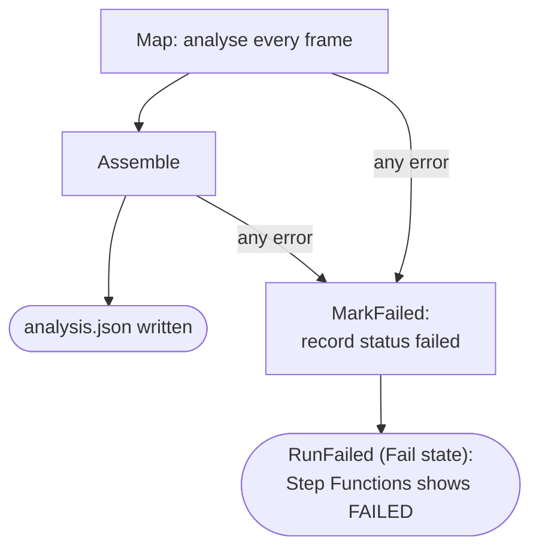
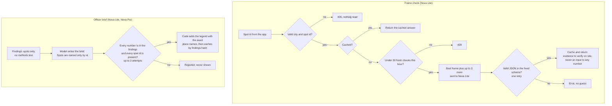
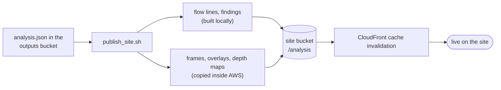

# Architecture

Everything here is deployed in `us-east-1`. Names in quotes are real resources. See the [README](../README.md) for what each part does and the [AWS notes](AWS_SUBMISSION.md) for resources, cost and teardown.

## 1. The whole system

```mermaid
flowchart LR
    subgraph Inputs
        V["Dashcam frames<br/>and phone sensors"]
        D["Copernicus GLO-30 and FABDEM<br/>(AWS Registry of Open Data)"]
        W["Drain maps"]
    end

    V -->|"upload frames.json"| RAW[("S3 raw bucket")]
    RAW -->|"EventBridge rule"| START["start-run Lambda"]
    START --> SFN["Step Functions<br/>floodlens-pipeline"]
    SFN -->|"one frame at a time"| INV["invoke-frame Lambda"]
    INV --> SM["SageMaker endpoint<br/>SegFormer-B2, Depth Anything V2,<br/>YOLOv8m-seg (GPU)"]
    SM --> OUT[("S3 outputs bucket")]
    SFN --> ASM["assemble-results Lambda<br/>water model per 60 m stretch"]
    D --> ASM
    W --> ASM
    ASM --> OUT

    OUT -->|"publish_site.sh"| SITE[("S3 site bucket")]
    SITE --> CF["CloudFront"]
    CF --> APP["Varshik web app<br/>React, MapLibre"]

    APP -->|"Function URL"| FC["frame-check Lambda"]
    APP -->|"Function URL"| BR["officer-brief Lambda"]
    APP -->|"Function URL"| ACT["actions Lambda"]
    FC --> BED["Amazon Bedrock<br/>Nova Lite"]
    BR --> BED2["Amazon Bedrock<br/>Nova Lite, Nova Pro"]
    ACT --> DDB[("DynamoDB<br/>FloodLensActions")]
    ACT -.->|"passcode"| SSM["Parameter Store"]

    SCHED["EventBridge Scheduler<br/>17:00 IST"] --> FCST["forecast Lambda"]
    FCST -->|"tomorrow's rain"| OM["Open-Meteo"]
    FCST --> SNS["SNS email"]
    FCST --> SITE
```

## 2. One survey through the pipeline

A Map state cannot carry hundreds of full records: Step Functions limits a state to 256 KB. That is why each record goes to S3 and only a pointer travels through the state machine.

## 3. Failure handling

Earlier versions ended `MarkFailed` normally, so a failed run showed SUCCEEDED. The only reliable success signal is still the output file `<sequence>-<size>/analysis.json`.

## 4. The AI features and their guardrails

## 5. Publishing a finished survey

The web app itself is published separately with `infra/deploy.sh` (or the manual **deploy** workflow).
